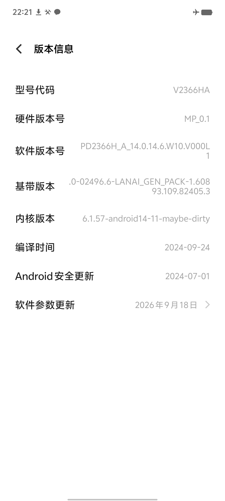
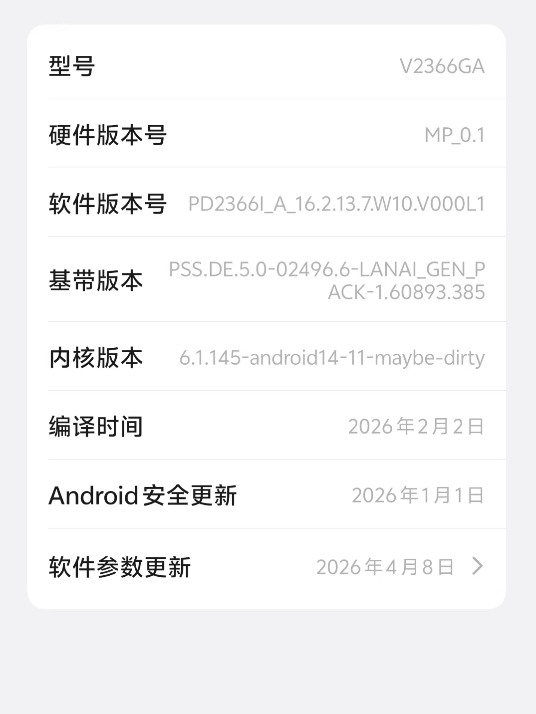
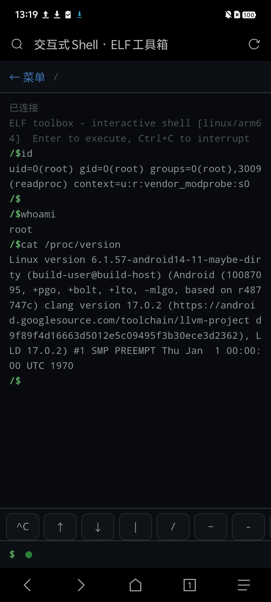
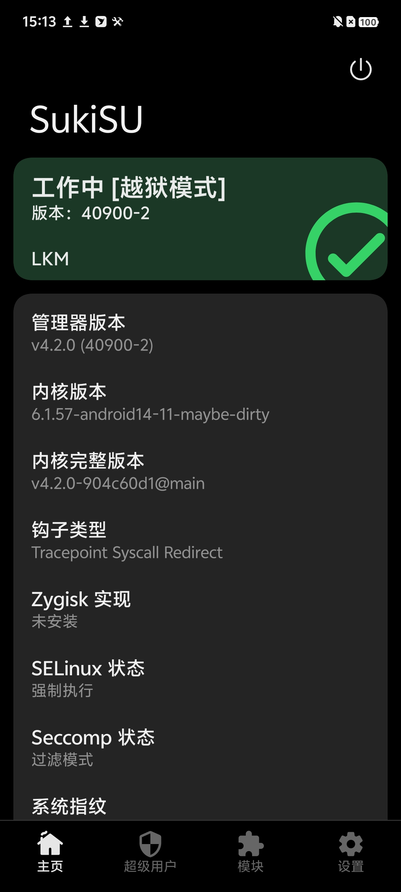
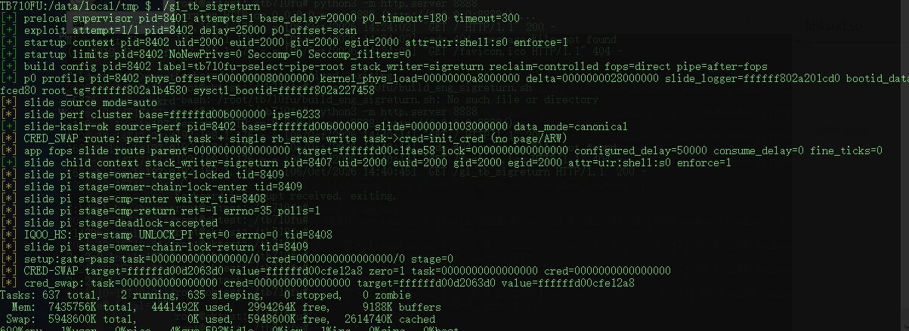
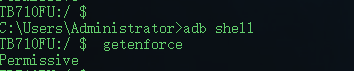
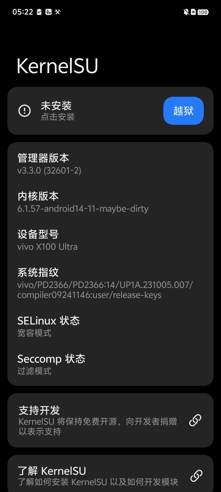

# vivo X100 Ultra (PD2366) — Root Research Notes

> 针对 vivo X100 Ultra（PD2366 / SM8650）
> 的内核 root 研究笔记。本文**只记录方法论、内核环境事实与已公开成果的整合路径**，
> 不包含可复现的利用细节(后续有空公开)。
> 至少三种独立漏洞到稳定宽容模式。

**仅供教育与安全研究使用。** 请仅在自有或获得授权的设备上实验。内核级操作存在
不可逆风险（数据丢失、设备损坏）。作者不对任何滥用行为负责。

---

## 0. 摘要

在未解锁 Bootloader 的前提下，PD2366（GKI 6.1.x，vivo 私有内核）上实现了：

- **稳定的 SELinux Permissive**（开机自动，无需人工干预）；
- **KernelSU（SukiSU）内核侧加载**，管理器正常工作、可持续授权；
- **一条独立于 KernelSU 的底层 root 通道**（内核 umh 原生上下文，
  SELinux 域为 `u:r:vendor_modprobe:s0`——本文对该链路仅此一句，细节不公开，见 §2）。

设备在上述状态下可通过主流 root 检测（隐藏状态良好），后续 KernelSU 模块生态可用。

> 为**避免厂商封死降级通道**，本文不会给出任何触发、利用或工程细节，仅确认其存在性。
> 请读者自行评估公开此类信息对整个社区的影响。

---

## 1. 目标环境

| 项 | 值 |
|---|---|
| 设备 | vivo X100 Ultra（V2366HA / PD2366） |
| SoC | Snapdragon 8 Gen 3（SM8650） |
| 内核 | `6.1.57-android14-11-maybe-dirty`（GKI 2.0，clang + KCFI + CFI） |
| 固件 | 官方降级至 14.0.14.6.W10.V000L1 对应内核基线 |
| 安全模块 | SELinux（enforcing）、vivo `vr.ko`（permanent，反 root）、DEFEX |

研究基线：bl 一如既往未解锁；所有改动 RAM 态，重启即净。

---

## 2. 路径一（细节不公开）：Dirty家族漏洞（多个独立洞可达）

存在多个dirty家族原句可写，可获得
`u:r:vendor_modprobe:s0` 上下文的 uid 0 执行能力，并以此引导后文所有成果。

**不公开的原因**：该原语与官方降级固件强绑定。一旦细节泄露，厂商只需封死降级，
整条研究路线（包括后来在降级内核上发展出的全部公开知识）都会随之失效。
我们选择把可公开的部分全部沉淀在 §3–§6 —— 它们独立于该原语，对任何已获得
等价入口的研究者都有价值。

---

## 3. 路径二：GhostLock（CVE-2026-43499）在 vivo 上的落地增量

GhostLock/IonStack（CVE-2026-43499）已由社区（NebuSec / Root-My-Galaxy /
KSuRoot / SukiSU-Ultra 等）公开并产品化。本节记录把**现有公开实现**在 vivo
6.1 GKI 上跑通所需的全部增量知识 —— 这些是本文认为最有复用价值的部分。

### 3.1 vivo umh（usermodehelper）上下文的三隔离事实

以内核辅助线程（umh）为宿主执行 payload 时，实测存在如下环境差异，任何
"内核态拉起用户态 daemon" 的方案都必须绕过：

| 事实 | 影响 |
|---|---|
| **独立 network namespace** | umh 内 `bind(127.0.0.1:*)` 后，主机侧 `/proc/net/tcp` 看不到监听；app/adb 连接 loopback 一律 `ECONNREFUSED`。TCP 类 root 桥在该上下文不可用 |
| **/data 视图不一致** | umh 侧写入的 /data 文件与 app 侧视图存在差异；两侧文件队列通信不可靠 |
| **/dev tmpfs 两侧共享** | umh 与 app 读写 `/dev` 下的同一 tmpfs 实例 —— 这是两侧唯一可靠的双向通道（marker 文件、文件队列都应放这里） |
| **umh 自带 seccomp** | `reboot(2)` 等 syscall 触发 `SIGSYS (SYS_SECCOMP)`。被拦截**不等于失败** —— 前序工作（如模块加载）已完成 |

**结论**：root 桥的可靠形态是 **`/dev` 下的文件队列**（轮询目录 + NUL 分隔
token 协议 + 4B LE 退出码），而非 TCP。

### 3.2 vr.ko 行为模型（逆向 + 实测）

vivo 的反 root 模块 `vr.ko`（`[permanent]`，不可 rmmod，自隐藏）通过以下机制工作：

- `tracepoint_probe_register_prio` 挂 `android_rvh_commit_creds`：凡
  `commit_creds` 后 `euid==0` 的任务被**打标**（task 结构两个标记字节）；
- 挂 `workqueue_execute_start/end` 观察内核辅助线程；
- 一个 kprobe + syscall 慢路径消费标记，对"标记过的 uid0"执行击杀；
- **完整性扫描**：会遍历 tracepoint 检查自身 probe 是否被动过 —— **直接把
  `tp->funcs` 置 NULL 致盲会被发现，并触发设备重启**；
- 挂 avc hook：检测 setenforce 类动作；在其恢复 enforcing 后，
  **即使内核已是 permissive，特定文件的写入仍会被该 hook 拦截**。

**安全/危险操作清单（实测）**：

| 操作 | 结果                       |
|---|--------------------------|
| umh 原生 uid0 进程（从未执行 `commit_creds`） | ✅ 不被打标，长期存活    |
| 该进程 `fork()` 出的子进程 | ✅ 继承 uid0，不被打标           |
| 用户态 `setuid(0)` / 新的 `euid==0` 转换 | ⛔ 打标 → 击杀/重启             |
| `insmod`（用户态发起） | ⛔ 触发检测（Neo9 研究 [3] 同样结论） |
| 清空 TP `funcs` 数组致盲 | ⚠️ 完整性扫描发现 → 死而不僵         |
| `setenforce 0`（显式调用） | ⚠️ 被监测并恢复 enforcing      |
| 内核数据写方式置 permissive | ✅ 可稳定的宽容模式      |

**实操结论**：需致盲vr.ko；
SELinux permissive 下部分安卓层会挂， 如system_server。 该状态也可利用组合技拿到root

### 3.3 稳定 Permissive 与 KernelSU 启用

- permissive 通过内核侧一次性数据写达成（`selinux_state.enforcing`）；
- vivo 官方内核对**内核模块**有三道门槛（详见 §5）：
  符号版本（MODVERSIONS）、vermagic（含 `vivo ` 尾缀）、必须保留 `.symtab`；
- KernelSU/SukiSU 的完整内核模块引用了 **50+ 个未导出符号**
  （`kallsyms_lookup_name`、SELinux 内部符号、`path_mount` 等）——
  **无法独立 insmod**。正确做法是 SukiSU 的 **capsule/late-load 机制**
  （手工重定位 + 从 kallsyms 解析符号 + 引导模块 finit），具体由管理器自带的
  `libksud.so late-load` 实现，在 root 上下文调用即可；
- `ksud` 首次运行需手工预建 `/data/adb/{ksu,modules,post-fs-data.d,service.d}`；
- late-load 尾部的 soft-reboot 在 umh seccomp 下触发 SIGSYS，属预期，不影响
  已完成的内核模块加载；
- **开发者选项 → 「停止限制子进程」必须开启**：vivo 的进程管理会回收
  root daemon fork 出的子进程（KSuRoot 文档同样强调此点 [2]）。

开机自动化：系统广播（`LOCKED_BOOT_COMPLETED`）→ 引导 → root 上下文 →
自动调用 late-load → KernelSU 上线，全程约 2 分钟，无需人工干预。

---

## 4. CVE-2026-64560 — posix-cpu-timers UAF（独立研究）

- 仓库：**CVE-2026-64560 Analysis**（分析 + Linux/Android NDK 触发验证型 PoC，
  不含提权原语）
- 概述：`posix-cpu-timers` 在非 leader 线程 `exec()` 竞争下的 Use-After-Free
  （CWE-416）。引入于 v5.7（2020），修复于 2026-07-29
  （mainline `920f893f735e`，backport 至 5.10.262 / 5.15.213 / 6.1.180 /
  6.6.147 / 6.12.100 等）。
- 对本设备的意义：**PD2366 的 6.1.57 | 6.1.124 | 6.1.145 处于受影响区间（< 6.1.180）**，
  联想平板tb710fu(6.1.112) 也适用
  且 2026-08 前的 SPL 基本都未合入修复 —— 这是一条与 GhostLock 完全独立的
  潜在入口，已经推进到稳定宽容态。
- 详细分析、竞态窗口时序图、PoC 与补丁验证见独立仓库（发布后附链接）。
- 也已经拿到稳定宽容模式，需要洪水攻击，不同布局扔有可能panic
- 可在宽容模式停下，不走creds，和43499一样走组合技拿root

---

## 5. vivo GKI 内核模块移植管线（通用知识）

无论以何种方式获得 root，想在 vivo 官方内核上加载自己的 `.ko`，都会碰到同一组
事实。这些是中性的工程知识，对移植任何内核模块（不止 root 类）都有用：

1. **MODVERSIONS CRC 真值只能取自设备镜像**：vivo 构建的内核，其
   `__kcrctab` CRC 与任何本地重建树**都不同**。正确做法：解包 boot.img 取
   `Image`，从 kallsyms 定位 `__start___ksymtab`（12 字节布局：
   value/name/namespace 三字段 i32 偏移）与 `__start___kcrctab`，按序号配对，
   即得全量 `符号 → CRC` 映射（6.1.57 约 1.5 万条）。
2. **vermagic 必须逐字节匹配**，含结尾的 `vivo ` 尾缀（注意空格）。
3. **模块必须保留 `.symtab`**：vivo 内核拒绝无符号表的模块（`--strip-debug`
   只去调试信息，不要全 strip）。
4. **KCFI/CFI**：内核 `CFI_CLANG=y`，模块需用 clang 构建并保持调用点
   KCFI 检查常量与目标内核一致；gcc 构建的模块会在 `do_one_initcall` 被 CFI 拦截。
5. **加载容器大小限制**：若采用页缓存写方式嵌入模块，容器文件的文件大小
   （不是空洞）决定上限；且跨页写入会污染相邻数据段 —— 模块要精确控制体积。
6. **QEMU 不能完全替代真机验证**：重建内核的 KCFI hash 与真机不同，
   同一模块在 QEMU 与真机上的 CFI 表现可能相反。QEMU 适合验证逻辑，真机才是终审。

---

## 6. 致谢与参考

- [NebuSec / IonStack — CVE-2026-43499 (GhostLock) 原始研究](https://nebusec.ai)
- [KernelSu](https://github.com/tiann/KernelSU) 及其 KPM 生态
- [ghostlock-app](https://github.com/YuKongA/ghostlock-app)
  [KSuRoot](https://github.com/hmascs/KSuRoot)
- [iQOO Neo9 root research on CVE-2025-21479（Adreno GPU SDS）](https://github.com/) ——
  vr.ko 逆向与 euid 规避策略参考 [3]
- upstream 修复：posix-cpu-timers UAF `920f893f735e`（CVE-2026-64560）

## 7. 防御视角

- 厂商侧：GKI 内核的 vendor hook（`android_rvh_*`）是把双刃剑，tracepoint
  完整性应纳入开机度量而非仅运行期扫描；umh 上下文的 net-ns/mount-ns 隔离
  是有效的纵深防御，但 `/dev` tmpfs 的跨命名空间共享值得重新评估；
- 社区侧：降级通道是安全研究的重要资产，"永远修复到最新"不等于"关闭旧入口"。
- 关闭自动更新，关闭自动更新参数。

---

## 结语

GhostLock 并不是终点, 别死磕这个啦。

有空就整理开源（没想起就算了...）

**除了 GhostLock，我们未必无路可走。**

---

*Research notes · vivo X100 Ultra · 2026.10*
